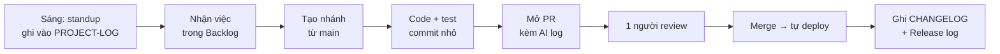

# GUIDE — Hướng dẫn cho cả nhóm

File này trả lời ba câu hỏi: **repo có gì, mình cần làm gì ngay, và làm việc hằng ngày thế nào.**

## 1. Việc cần làm ngay (trước 23:59 ngày 15/11/2026 — hạn Gate 1)

### Mỗi thành viên

1. Clone repo và chuyển sang nhánh đang chứa tài liệu:

   ```bash
   git clone https://github.com/minhiuss/VinUni-FinalProject-VF020-15-404BrainNotFound.git
   ```

   ```bash
   git checkout zMerkurias
   ```

2. Đọc theo thứ tự: [Brief](docs/01-brief.md) (2 phút) → [PRD](docs/02-prd.md) (15 phút) → [Wireframe](docs/03-wireframe-ui-flow.md) (10 phút).
3. Ghi ý kiến: sửa thẳng trên nhánh riêng của bạn rồi mở PR, hoặc nhắn vào kênh chat của nhóm. Chỗ nào không đồng ý thì nói ngay bây giờ; sau gate sẽ khó đổi hơn.
4. Điền tên, tài khoản GitHub và vai trò của mình vào bảng **Nhóm** trong [README](README.md).

### Trưởng nhóm

- [ ] Gom ý kiến, chốt Brief, PRD, Wireframe.
- [ ] Đọc Technical Book chương 02 ("Khởi tạo dự án từ Template") và hoàn tất phần AI Log theo đúng hướng dẫn của portal — xem [ai-logs/README.md](ai-logs/README.md). **Phần này hiện mới là bản tạm.**
- [ ] Merge nhánh tài liệu vào `main`, bật bảo vệ nhánh `main`.
- [ ] Nộp link repo lên portal (mục Gate → G1). Một người nộp là cả nhóm được tính.
- [ ] Ghi một dòng vào [PROJECT-LOG.md](PROJECT-LOG.md).

### Checklist Gate 1

| Deliverable | File | Tình trạng |
|---|---|---|
| Brief | [docs/01-brief.md](docs/01-brief.md) | Nháp — chờ duyệt |
| PRD | [docs/02-prd.md](docs/02-prd.md) | Nháp — chờ duyệt |
| Wireframe / UI Flow | [docs/03-wireframe-ui-flow.md](docs/03-wireframe-ui-flow.md) | Nháp — chờ duyệt |
| GitHub Repo AI Log Setup | [ai-logs/](ai-logs/) | Bản tạm — cần đối chiếu Technical Book |

## 2. Từng file dùng để làm gì

### Ở gốc repo

| File | Là gì | Ai sửa | Khi nào |
|---|---|---|---|
| [README.md](README.md) | Trang giới thiệu. Người ngoài nhóm và giám khảo đọc đầu tiên | Cả nhóm | Khi cấu trúc repo, cách cài đặt hoặc trạng thái gate thay đổi |
| [GUIDE.md](GUIDE.md) | File này | Trưởng nhóm | Khi quy trình thay đổi |
| [CONTRIBUTING.md](CONTRIBUTING.md) | Quy tắc nhánh, commit, PR, review | Cả nhóm thống nhất | Hiếm khi |
| [PROJECT-LOG.md](PROJECT-LOG.md) | Nhật ký chung: trạng thái, checklist chuẩn bị, standup, quyết định, rủi ro, báo cáo tuần | **Mọi người, mỗi ngày** | Mỗi khi làm xong một việc |
| [CHANGELOG.md](CHANGELOG.md) | Lịch sử release, viết cho người dùng đọc | Người deploy | Mỗi lần deploy lên production |
| [.env.example](.env.example) | Danh sách biến môi trường cần có, không chứa giá trị thật | Người thêm biến mới | Cùng PR thêm biến |
| [.gitignore](.gitignore) | Danh sách file không đưa lên git | Ai cần thì thêm | — |
| [.github/pull_request_template.md](.github/pull_request_template.md) | Khung mô tả tự hiện khi mở PR | — | — |

### `docs/` — tài liệu nộp gate

| File | Là gì | Dùng khi |
|---|---|---|
| [01-brief.md](docs/01-brief.md) | Tóm tắt 1 trang: vấn đề, người dùng, giải pháp, phạm vi, chỉ số | Giới thiệu dự án; kiểm tra một ý tưởng mới có nằm trong phạm vi không |
| [02-prd.md](docs/02-prd.md) | Yêu cầu sản phẩm. Mỗi yêu cầu có mã `F-xx`, mức ưu tiên và user story liên quan | Trước khi code một tính năng: tìm mã `F-xx` tương ứng và làm đúng mô tả. Ghi mã này vào PR |
| [03-wireframe-ui-flow.md](docs/03-wireframe-ui-flow.md) | Sơ đồ màn hình và khung từng màn hình (`S1`–`S7`, `A1`–`A3`, `D1`) | Trước khi làm giao diện |

### `docs/preparation/` — tài liệu nền

Viết ở bước chuẩn bị. PRD và Brief tóm tắt từ đây; cần chi tiết thì mở các file này.

| File | Trả lời câu hỏi |
|---|---|
| [00-de-bai-pham-vi.md](docs/preparation/00-de-bai-pham-vi.md) | Đề yêu cầu gì? Giám khảo chấm những mục nào? |
| [01-project-charter.md](docs/preparation/01-project-charter.md) | Mục tiêu, vai trò, cột mốc, rủi ro, quy chế nhóm |
| [02-user-stories.md](docs/preparation/02-user-stories.md) | 10 user story kèm tiêu chí nghiệm thu (UAT), chia theo tuần |
| [03-bai-hoc-tu-vucar.md](docs/preparation/03-bai-hoc-tu-vucar.md) | Sản phẩm tương tự làm thế nào? Nhóm học gì, khác gì? |
| [04-kien-truc-prod-cicd.md](docs/preparation/04-kien-truc-prod-cicd.md) | Kiến trúc, tech stack, server production, CI/CD, bảo mật |
| [05-eval-test.md](docs/preparation/05-eval-test.md) | Unit test, bộ eval, integration test, UAT |
| [06-ke-hoach-du-lieu.md](docs/preparation/06-ke-hoach-du-lieu.md) | Lấy dữ liệu giá ở đâu, bao nhiêu, làm sạch thế nào |
| [07-cau-hoi-mo.md](docs/preparation/07-cau-hoi-mo.md) | Những điều chưa rõ, cần hỏi mentor hoặc nhóm tự chốt |

### `docs/management/`

| File | Là gì |
|---|---|
| [project-management.xlsx](docs/management/project-management.xlsx) | File quản trị dựng theo template của mentor: Tổng hợp (có 3 biểu đồ), Backlog (39 việc), User Story, Checklist đề bài, Release log, Eval log, Lộ trình, Thành viên, Links, Bugs, Burndown |

**Cách dùng:** tải file này lên Google Drive chung, mở bằng Google Sheets, và từ đó **chỉ sửa bản trên Drive** (file Excel trong git không cho 4 người sửa cùng lúc). Dán link bản Drive vào `PROJECT-LOG.md`. Việc đầu tiên là điền ngày bắt đầu vào ô vàng `B6` của sheet Tổng hợp.

### `ai-logs/`

| File | Là gì |
|---|---|
| [README.md](ai-logs/README.md) | Quy tắc ghi log dùng AI |
| [TEMPLATE.md](ai-logs/TEMPLATE.md) | Mẫu để copy |
| `YYYY-MM-DD-<ten-github>.md` | Log của từng người theo ngày |

## 3. Làm việc hằng ngày



1. **Standup** — mỗi sáng thêm 3 dòng vào mục 4 của `PROJECT-LOG.md`: hôm qua, hôm nay, kẹt gì.
2. **Nhận việc** — mỗi việc trong Backlog có một người phụ trách và một hạn chót.
3. **Làm trên nhánh riêng**, commit nhỏ và thường xuyên. Quy tắc đặt tên: [CONTRIBUTING.md](CONTRIBUTING.md).
4. **Mở PR** dưới 400 dòng, ghi mã user story hoặc mã yêu cầu `F-xx`.
5. **Sau khi merge và deploy** — thêm một dòng vào `CHANGELOG.md` và sheet Release log.
6. **Cuối tuần** — cả 4 người chạy UAT của các user story trong tuần trên bản production, bằng điện thoại của mình. Đủ 4/4 thì user story mới được tính là xong.

## 4. Chuẩn bị cho Gate 2 (MVP)

Luồng MVP: khách nhập thông tin xe → nhận khoảng giá có cơ sở và cảnh báo tạm tính → agent hỏi lại khi thiếu thông tin (PRD mục 9 và 10).

| Deliverable | Sẽ nằm ở | Ghi chú |
|---|---|---|
| Video demo 3 phút | Link trong `README.md` | Quay trên bản đã deploy, đi hết luồng |
| Sơ đồ kiến trúc | `docs/04-architecture.md` | Bản nháp đã có trong [preparation/04](docs/preparation/04-kien-truc-prod-cicd.md) |
| ≥ 10 PR đã merge | GitHub | **Chia việc thành PR nhỏ ngay từ đầu.** Mỗi người mở PR cho phần mình làm, đừng gộp |
| README cài đặt | `README.md` mục "Cài đặt và chạy" | Các bước cài, biến môi trường, câu hỏi mẫu |
| ≥ 5 ca kiểm thử thủ công | `evals/manual-test-cases.md` | Mỗi ca: đầu vào, kết quả mong đợi, **đầu ra thực tế** (ảnh chụp hoặc JSON) |

## 5. Những điều không được làm

- Không push thẳng lên `main`.
- Không commit `.env`, API key, mật khẩu, ảnh xe hoặc số điện thoại của khách.
- Không để LLM tự tính số tiền. Mọi con số đi qua engine có test.
- Không gọi một giá là "chính thức" khi thẩm định viên chưa chốt.
- Không thêm user story mới vào sprint đã chốt.

## 6. Tài liệu bên ngoài

| Tài liệu | Ở đâu |
|---|---|
| Technical Book (15 chương) | Portal → Sổ tay kỹ thuật — cần đăng nhập |
| Tài liệu quản trị dự án của mentor | [Google Drive](https://drive.google.com/drive/folders/1jI-v0E1z5eIf2xGs5SDyElY1mr0qOKhI) |
| Trang tham khảo (không sao chép) | <https://dinhgiaxe.vucar.vn/> |
