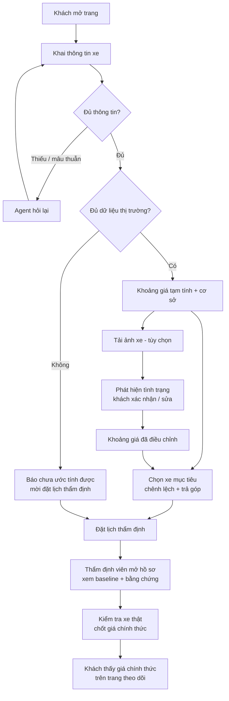

# PRD — AI Agent hỗ trợ đổi xe cũ (Trade-in)

| | |
|---|---|
| Mã đề | VFO2O-15 |
| Nhóm | 404BrainNotFound |
| Phiên bản | 1.0 — 12/11/2026 |
| Trạng thái | Nháp, chờ cả nhóm duyệt |
| Tài liệu liên quan | [Brief](01-brief.md) · [Wireframe / UI Flow](03-wireframe-ui-flow.md) · [User stories chi tiết](preparation/02-user-stories.md) |

## 1. Bối cảnh và vấn đề

Nhiều khách muốn đổi xe cũ lấy xe điện, nhưng quy trình định giá xe cũ chậm và thiếu minh bạch. Mỗi nơi báo một giá, khách không có mốc để so sánh nên e ngại, giao dịch kéo dài. Quyết định đổi xe còn phụ thuộc vào bài toán tài chính: phải bù bao nhiêu, trả góp thế nào, chi phí sở hữu ra sao.

Phía doanh nghiệp, nhân viên tư vấn và thẩm định viên định giá theo kinh nghiệm riêng. Họ không có một mức tham chiếu trung lập để bắt đầu và để giải thích với khách.

## 2. Mục tiêu

| # | Mục tiêu | Đo bằng |
|---|---|---|
| G1 | Khách có một khoảng giá thu mua có căn cứ, nhanh | Thời gian từ lúc mở trang đến lúc thấy giá dưới 3 phút |
| G2 | Khoảng giá đủ sát để có ích | Sai lệch trung bình ≤ 15%; ≥ 70% giá thẩm định nằm trong khoảng; trên ≥ 20 ca |
| G3 | Thẩm định viên có baseline trung lập và là người quyết định cuối | 100% giá chính thức do thẩm định viên chốt |
| G4 | Khách thấy được bài toán tài chính khi lên đời | Chênh lệch, trả góp, TCO khớp bảng tính tay ở mọi ca kiểm thử |
| G5 | Sản phẩm chạy thật | Chạy trên production, dùng được trên điện thoại, release liên tục |

**Không phải mục tiêu:** thay thế thẩm định viên; đưa ra giá chính thức tự động; trở thành sàn mua bán xe.

## 3. Người dùng

### 3.1 Khách — người muốn bán hoặc đổi xe

- Có một ô tô cá nhân đang dùng, đang cân nhắc chuyển sang xe điện.
- Không rành thông số kỹ thuật, không biết giá thị trường.
- Dùng điện thoại là chính, thường mở link từ Zalo hoặc Facebook.
- **Nỗi đau:** không biết giá nào là hợp lý; sợ bị ép giá; phải đi nhiều nơi.

### 3.2 Thẩm định viên / nhân viên tư vấn

- Làm việc tại showroom hoặc đại lý, định giá nhiều xe mỗi ngày.
- **Nỗi đau:** không có mức tham chiếu chung; mỗi người một giá; khó giải thích với khách vì sao ra con số đó.

### 3.3 Quản lý chương trình trade-in (phụ)

- Cần biết baseline đáng tin đến đâu và khách rơi rụng ở bước nào.

## 4. Hành trình người dùng



## 5. Yêu cầu chức năng

Mức ưu tiên: **P0** bắt buộc cho Gate 2 (MVP) · **P1** bắt buộc để đủ mục Cơ bản của đề · **P2** mục Nâng cao.

### 5.1 Khai thông tin xe

| Mã | Yêu cầu | Ưu tiên | US |
|---|---|---|---|
| F-01 | Chọn lần lượt hãng → dòng → đời → phiên bản từ danh mục chuẩn; nhập số km | P0 | US-01 |
| F-02 | Mỗi bước chỉ hiện lựa chọn hợp lệ theo bước trước | P0 | US-01 |
| F-03 | Có lựa chọn "Tôi không rõ" cho phiên bản; khi đó khoảng giá rộng hơn và có ghi chú | P0 | US-02 |
| F-04 | Phát hiện đầu vào mâu thuẫn và hỏi xác nhận lại, không tự sửa | P0 | US-02 |
| F-05 | Khai tình trạng cơ bản bằng câu hỏi chọn nhanh (va chạm, ngập nước, số đời chủ) | P1 | US-01 |

### 5.2 Định giá sơ bộ

| Mã | Yêu cầu | Ưu tiên | US |
|---|---|---|---|
| F-06 | Trả về **khoảng giá** thu mua (thấp – cao), không trả một con số | P0 | US-01 |
| F-07 | Hiện cơ sở tính: số xe tương đồng, nguồn, ngày dữ liệu, ít nhất 3 xe tương đồng, từng dòng điều chỉnh | P0 | US-01 |
| F-08 | Cảnh báo "Giá tạm tính — giá chính thức do thẩm định viên quyết định" nằm cạnh con số | P0 | US-01 |
| F-09 | Xe ngoài danh mục hoặc quá ít dữ liệu: báo "chưa đủ dữ liệu để ước tính", không đưa số | P0 | US-01 |
| F-10 | Cùng đầu vào và cùng phiên bản dữ liệu cho ra cùng kết quả | P0 | US-01 |

### 5.3 Ảnh và tình trạng

| Mã | Yêu cầu | Ưu tiên | US |
|---|---|---|---|
| F-11 | Tải hoặc chụp ảnh theo các góc được hướng dẫn | P1 | US-03 |
| F-12 | Model nhìn ảnh, trả về danh sách phát hiện có cấu trúc: vị trí, loại, mức độ | P1 | US-03 |
| F-13 | Khách sửa hoặc bỏ được từng phát hiện trước khi áp vào giá | P1 | US-03 |
| F-14 | Mức trừ theo từng phát hiện lấy từ bảng quy tắc trong code và hiện rõ cho khách | P1 | US-03 |
| F-15 | Ảnh không dùng được (mờ, tối, không phải xe): yêu cầu chụp lại | P1 | US-03 |

### 5.4 Lên đời xe điện

| Mã | Yêu cầu | Ưu tiên | US |
|---|---|---|---|
| F-16 | Chọn mẫu xe mục tiêu; hiện giá lăn bánh và số tiền cần bù ở cả hai đầu khoảng giá | P1 | US-04 |
| F-17 | Tính lịch trả góp theo số tiền trả trước, kỳ hạn, lãi suất | P1 | US-04 |
| F-18 | Gợi ý tối đa 3 mẫu xe vừa ngân sách sau trade-in | P2 | US-08 |
| F-19 | Bảng chi phí sở hữu 5 năm so với việc giữ xe cũ | P2 | US-08 |
| F-20 | Agent trả lời thắc mắc, phản đối; có dẫn số từ engine hoặc trích tài liệu chính sách | P2 | US-08 |

### 5.5 Thẩm định và chốt giá

| Mã | Yêu cầu | Ưu tiên | US |
|---|---|---|---|
| F-21 | Đặt lịch thẩm định: ngày giờ, địa điểm, số điện thoại | P1 | US-05 |
| F-22 | Hai vai trò có phân quyền: khách, thẩm định viên | P1 | US-06 |
| F-23 | Thẩm định viên xem danh sách hồ sơ và chi tiết: thông tin xe, ảnh, phát hiện, baseline, xe tương đồng | P1 | US-06 |
| F-24 | Thẩm định viên nhập giá chính thức; nếu ngoài khoảng baseline thì bắt buộc chọn lý do | P1 | US-06 |
| F-25 | Khách chỉ thấy "giá chính thức" sau khi thẩm định viên chốt | P1 | US-06 |
| F-26 | Lưu vết mỗi lần chốt: ai, lúc nào, giá, lý do | P1 | US-06 |

### 5.6 Theo dõi và đo lường

| Mã | Yêu cầu | Ưu tiên | US |
|---|---|---|---|
| F-27 | Khách theo dõi trạng thái hồ sơ bằng mã hồ sơ | P2 | US-07 |
| F-28 | Trang đo sai lệch giá ước tính so với giá thẩm định | P2 | US-09 |
| F-29 | Phễu chuyển đổi: định giá → đặt lịch → chốt giá | P2 | US-10 |

## 6. Yêu cầu phi chức năng

| Nhóm | Yêu cầu |
|---|---|
| **Tính toán xác định** | Mọi con số tiền (khoảng giá, mức trừ, chênh lệch, trả góp, TCO) do code tính và có unit test. LLM không tạo ra số tiền. Mọi hệ số nằm trong file cấu hình, có nguồn và ngày cập nhật |
| **HITL** | Hệ thống không bao giờ gọi một giá là "chính thức" nếu thẩm định viên chưa chốt |
| **Minh bạch** | Mọi khoảng giá đi kèm nguồn dữ liệu, ngày dữ liệu, xe tương đồng và các dòng điều chỉnh |
| **Bảo mật** | Ảnh lưu trong kho riêng tư, mã hóa, truy cập bằng link ký có thời hạn; xóa dữ liệu vị trí trong ảnh; phân quyền kiểm tra ở backend; không ghi số điện thoại, biển số vào log |
| **Chi phí** | Nén ảnh trước khi gửi; giới hạn số ảnh mỗi hồ sơ; giới hạn số yêu cầu theo IP; ghi lại chi phí LLM mỗi hồ sơ |
| **Tốc độ** | Trang đầu dưới 3 giây; định giá không ảnh dưới 2 giây; có ảnh dưới 15 giây kèm trạng thái đang xử lý |
| **Thiết bị** | Dùng tốt trên điện thoại từ 360 px; Chrome, Safari, trình duyệt trong Zalo và Facebook; mạng 4G yếu |
| **Độ tin cậy** | Mất mạng giữa chừng không mất dữ liệu đã nhập; lỗi từ model có thông báo và nút thử lại |
| **Vận hành** | CI chạy test trên mỗi PR; merge vào nhánh chính tự deploy; có smoke test và log release |

## 7. Thiết kế AI

| Thành phần | Vai trò | Không được làm |
|---|---|---|
| **Agent (LangGraph)** | Hỏi lại thông tin thiếu; chọn tool cần gọi; diễn giải kết quả bằng lời | Tự tính hoặc tự nghĩ ra số tiền; gọi giá là "chính thức" |
| **Vision** | Mô tả hư hỏng trong ảnh thành dữ liệu có cấu trúc | Quy đổi hư hỏng thành tiền |
| **RAG** | Trả lời về chính sách trade-in, có trích nguồn | Trả lời khi không tìm thấy tài liệu liên quan |
| **Engine xác định** | Khoảng giá, mức trừ, chênh lệch, trả góp, TCO | — |

Cách định giá:

```
giá rao trung vị của xe tương đồng (cùng dòng, phiên bản, đời ± 1, km gần)
  → trừ biên thương lượng      (giá rao → giá giao dịch)
  → trừ biên đại lý            (giá giao dịch → giá thu mua)
  → trừ điều chỉnh tình trạng  (khai báo + ảnh, có trần)
= khoảng giá thu mua tạm tính  (độ rộng theo số lượng và độ phân tán của xe tương đồng)
```

## 8. Dữ liệu

| Dữ liệu | Nguồn | Mục tiêu |
|---|---|---|
| Tin rao xe cũ | Các trang rao vặt công khai; chỉ lấy thông tin xe, không lấy thông tin người rao | 2.000–3.000 tin sạch, khoảng 10 mẫu xe |
| Danh mục xe chuẩn | Nhóm tự dựng từ tin rao và trang hãng | Mọi tin rao và mọi lựa chọn trong wizard khớp vào đây |
| Xe mục tiêu và giá lăn bánh | Trang công khai của hãng | Toàn bộ mẫu và phiên bản |
| Giá thẩm định | Thẩm định viên hoặc người trong nghề | ≥ 20 ca |
| Ảnh gán nhãn | Nhóm tự gán + bộ dữ liệu công khai | 40–60 ảnh cho eval |
| Chính sách trade-in | Trang công khai của hãng | 5–15 tài liệu |

Chi tiết: [Kế hoạch dữ liệu](preparation/06-ke-hoach-du-lieu.md).

## 9. Phạm vi theo gate

| Gate | Nội dung | Yêu cầu trong PRD |
|---|---|---|
| **G1 — Chốt đề tài** | Brief, PRD, wireframe, repo | — |
| **G2 — MVP** | Một luồng thật từ đầu đến cuối: khai thông tin → khoảng giá có cơ sở → hỏi lại khi thiếu | F-01 đến F-04, F-06 đến F-10 |
| Sau G2 | Ảnh, lên đời, đặt lịch, thẩm định viên chốt giá | F-05, F-11 đến F-17, F-21 đến F-26 |
| Hoàn thiện | Gợi ý xe, TCO, tracker, eval, dashboard | F-18 đến F-20, F-27 đến F-29 |

**Ngoài phạm vi:** xe máy, xe tải, xe hiếm; chẩn đoán máy và gầm qua ảnh; tích hợp ngân hàng và thanh toán; đồng bộ lịch showroom thật; app native. Ước tính tiêu hao pin và trạm sạc theo lộ trình: để ngỏ, chờ xác nhận của mentor.

## 10. Tiêu chí nghiệm thu MVP (Gate 2)

1. Trên bản đã deploy, người dùng thật nhập một xe thuộc danh mục và nhận khoảng giá kèm cơ sở tính và cảnh báo tạm tính. Không có bước nào dùng dữ liệu giả.
2. Bỏ trống hoặc nhập mâu thuẫn một trường thì agent hỏi lại đúng trường đó.
3. Nhập một xe ngoài danh mục thì hệ thống báo chưa ước tính được.
4. Có ít nhất 5 ca kiểm thử thủ công kèm đầu ra thực tế.
5. Repo có ít nhất 10 PR đã merge, README hướng dẫn cài đặt, sơ đồ kiến trúc và video demo 3 phút.

## 11. Rủi ro và giả định

| Rủi ro | Cách xử lý |
|---|---|
| Không thu được dữ liệu giá đủ sạch | Thu mẫu 200 tin trước khi code; thu hẹp danh mục xe |
| Giá rao khác giá thu mua | Hai hệ số biên có nguồn, hiển thị cho người dùng, hiệu chỉnh bằng ca thẩm định thật |
| Không có thẩm định viên thật cho eval | Nhờ mentor kết nối; phương án thay thế ghi trong [Eval & Test](preparation/05-eval-test.md) |
| Vision đoán sai | Khách xác nhận từng phát hiện; mức trừ có trần; thẩm định viên quyết định cuối |
| Phình phạm vi | Sprint đã chốt thì không thêm user story |
| Dịch vụ miễn phí chậm lúc demo | Ping giữ thức; nâng gói trong tuần demo |

**Giả định:** nhóm được dùng dữ liệu rao vặt công khai cho mục đích học tập; xe mục tiêu là xe điện của một hãng; lãi suất và giá lăn bánh là số minh họa có ghi ngày.

## 12. Câu hỏi còn mở

Xem [Câu hỏi mở](preparation/07-cau-hoi-mo.md). Ba câu chặn tiến độ: nguồn giá thẩm định thật, lịch chính thức của các gate, và mục pin / trạm sạc có bắt buộc không.
