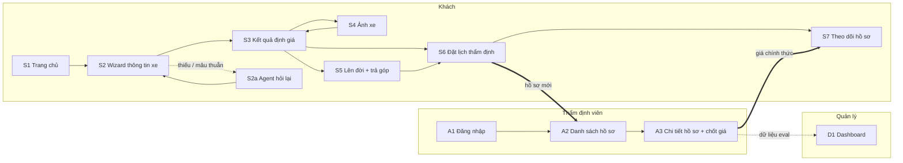

# Wireframe / UI Flow

Bản phác màn hình ở mức khung (low-fidelity), thiết kế cho điện thoại trước. Mã yêu cầu `F-xx` tham chiếu [PRD](02-prd.md).

## 1. Sơ đồ màn hình



**Phạm vi Gate 2 (MVP):** S1, S2, S2a, S3. Các màn hình còn lại làm sau.

## 2. Màn hình của khách

### S1 — Trang chủ

```
┌──────────────────────────────┐
│ [logo]              Đăng nhập│
├──────────────────────────────┤
│                              │
│  Xe của bạn đáng bao nhiêu   │
│  khi đổi sang xe điện?       │
│                              │
│  Khoảng giá có căn cứ        │
│  trong 3 phút. Miễn phí.     │
│                              │
│  ┌────────────────────────┐  │
│  │   BẮT ĐẦU ĐỊNH GIÁ     │  │
│  └────────────────────────┘  │
│                              │
│  Đã có mã hồ sơ? Theo dõi →  │
├──────────────────────────────┤
│ ① Khai xe  ② Xem giá        │
│ ③ Đặt lịch ④ Chốt giá       │
├──────────────────────────────┤
│ ⓘ Giá trên trang là tạm tính.│
│   Giá chính thức do thẩm     │
│   định viên quyết định.      │
└──────────────────────────────┘
```

### S2 — Wizard thông tin xe (F-01 đến F-05)

Mỗi bước một câu hỏi, một màn hình. Bước sau chỉ hiện lựa chọn hợp lệ theo bước trước.

```
┌──────────────────────────────┐
│ ←   Bước 4 / 6               │
│ ████████████░░░░░░           │
├──────────────────────────────┤
│ Toyota · Vios · 2019         │  ← tóm tắt các bước đã chọn
│                              │
│ Phiên bản xe của bạn?        │
│                              │
│ ┌──────────────────────────┐ │
│ │ ○ 1.5E MT                │ │
│ │ ○ 1.5E CVT               │ │
│ │ ○ 1.5G CVT               │ │
│ │ ○ Tôi không rõ           │ │  ← F-03
│ └──────────────────────────┘ │
│                              │
│ ⓘ Xem trên giấy đăng kiểm    │
│   hoặc đuôi xe.              │
│                              │
│ ┌──────────────────────────┐ │
│ │        TIẾP TỤC          │ │
│ └──────────────────────────┘ │
└──────────────────────────────┘
```

| Bước | Câu hỏi | Kiểu nhập |
|---|---|---|
| 1 | Hãng xe | Lưới logo + ô tìm |
| 2 | Dòng xe | Danh sách |
| 3 | Đời xe | Danh sách năm |
| 4 | Phiên bản | Danh sách + "Tôi không rõ" |
| 5 | Số km đã đi | Ô số + các mốc chọn nhanh |
| 6 | Tình trạng cơ bản | Câu hỏi chọn nhanh: từng va chạm? ngập nước? mấy đời chủ? |

### S2a — Agent hỏi lại (F-03, F-04)

Hiện ngay trong wizard khi đầu vào thiếu hoặc mâu thuẫn.

```
┌──────────────────────────────┐
│ ←   Bước 5 / 6               │
├──────────────────────────────┤
│ Số km đã đi?                 │
│ ┌──────────────────────────┐ │
│ │ 400.000              km  │ │
│ └──────────────────────────┘ │
│                              │
│ ┌──────────────────────────┐ │
│ │ 🤖 Xe đời 2023 mà đã đi  │ │
│ │ 400.000 km là cao bất    │ │
│ │ thường. Bạn kiểm tra lại │ │
│ │ giúp mình nhé?           │ │
│ │                          │ │
│ │ [Sửa lại]  [Đúng rồi]    │ │
│ └──────────────────────────┘ │
└──────────────────────────────┘
```

### S3 — Kết quả định giá (F-06 đến F-10)

Màn hình quan trọng nhất. Khoảng giá và cảnh báo tạm tính nằm trong màn hình đầu, không cần cuộn.

```
┌──────────────────────────────┐
│ ←  Toyota Vios 1.5G CVT 2019 │
│    62.000 km            [Sửa]│
├──────────────────────────────┤
│ GIÁ THU MUA TẠM TÍNH         │
│                              │
│   365 – 395 triệu            │
│                              │
│ ⚠ Giá tạm tính. Giá chính    │
│   thức do thẩm định viên     │
│   quyết định sau khi xem xe. │
├──────────────────────────────┤
│ VÌ SAO RA CON SỐ NÀY?        │
│ Giá rao trung vị    430 tr   │
│ (18 xe tương đồng)           │
│ − Biên thương lượng −13 tr   │
│ − Biên đại lý       −34 tr   │
│ − Tình trạng         −3 tr   │
│ ─────────────────────────    │
│ Điểm giữa           380 tr   │
│ Nguồn: [A], [B], [C]         │
│ Dữ liệu ngày 10/11/2026      │
├──────────────────────────────┤
│ XE TƯƠNG ĐỒNG ĐANG RAO       │
│ 1.5G 2019 · 58.000km · 435tr→│
│ 1.5G 2019 · 70.000km · 420tr→│
│ 1.5G 2020 · 61.000km · 448tr→│
│ Xem tất cả 18 xe             │
├──────────────────────────────┤
│ ┌──────────────────────────┐ │
│ │ 📷 Thêm ảnh để giá sát   │ │
│ │    hơn                   │ │
│ └──────────────────────────┘ │
│ ┌──────────────────────────┐ │
│ │ Xem phương án lên đời    │ │
│ └──────────────────────────┘ │
│ ┌──────────────────────────┐ │
│ │ ĐẶT LỊCH THẨM ĐỊNH       │ │
│ └──────────────────────────┘ │
│                              │
│ 💬 Hỏi về kết quả này        │
└──────────────────────────────┘
```

Các con số trong khung chỉ để minh họa bố cục.

**Trạng thái thiếu dữ liệu (F-09):** thay khối giá bằng thông báo "Chưa đủ dữ liệu để ước tính cho xe này", kèm lý do và nút "Đặt lịch thẩm định". Không hiện con số nào.

### S4 — Ảnh xe (F-11 đến F-15)

```
┌──────────────────────────────┐
│ ←  Ảnh xe            3 / 6   │
├──────────────────────────────┤
│ ┌──────┐ ┌──────┐ ┌──────┐   │
│ │ Trước│ │ Sau  │ │ Trái │   │
│ │  ✓   │ │  ✓   │ │  ✓   │   │
│ └──────┘ └──────┘ └──────┘   │
│ ┌──────┐ ┌──────┐ ┌──────┐   │
│ │ Phải │ │ Nội  │ │ Đồng │   │
│ │  +   │ │ thất+│ │ hồ + │   │
│ └──────┘ └──────┘ └──────┘   │
├──────────────────────────────┤
│ ĐÃ PHÁT HIỆN — bạn kiểm tra  │
│ ┌──────────────────────────┐ │
│ │ Cản sau · Móp · Vừa      │ │
│ │ −4 tr      [Sửa] [Bỏ]    │ │
│ ├──────────────────────────┤ │
│ │ Cửa trái · Xước · Nhẹ    │ │
│ │ −1 tr      [Sửa] [Bỏ]    │ │
│ └──────────────────────────┘ │
│ + Thêm hư hỏng khác          │
│                              │
│ ☑ Tôi đồng ý cho lưu ảnh để  │
│   thẩm định. Chi tiết →      │
│ ┌──────────────────────────┐ │
│ │   CẬP NHẬT KHOẢNG GIÁ    │ │
│ └──────────────────────────┘ │
└──────────────────────────────┘
```

Ảnh mờ, tối hoặc không phải xe: ô ảnh hiện viền đỏ và dòng "Ảnh chưa rõ, chụp lại giúp mình".

### S5 — Lên đời + trả góp (F-16, F-17)

```
┌──────────────────────────────┐
│ ←  Phương án lên đời         │
├──────────────────────────────┤
│ Xe bạn muốn đổi sang         │
│ ┌──────────────────────────┐ │
│ │ [Mẫu xe]  [Phiên bản]  ▾ │ │
│ └──────────────────────────┘ │
│ Giá lăn bánh        7xx tr   │
│ Xe cũ (tạm tính) 365–395 tr  │
│ ─────────────────────────    │
│ CẦN BÙ           3xx–3xx tr  │
├──────────────────────────────┤
│ TRẢ GÓP PHẦN CÒN LẠI         │
│ Trả trước   [────●────] 30%  │
│ Kỳ hạn      [ 60 tháng  ▾]   │
│ Lãi suất    [ 8,5 % / năm ]  │
│                              │
│ Mỗi tháng         ≈ x,x tr   │
│ Tổng lãi          ≈ xx tr    │
│ Xem lịch trả chi tiết →      │
│                              │
│ ⓘ Lãi suất và giá lăn bánh   │
│   là số minh họa, cập nhật   │
│   ngày ../../....            │
│ ┌──────────────────────────┐ │
│ │   ĐẶT LỊCH THẨM ĐỊNH     │ │
│ └──────────────────────────┘ │
└──────────────────────────────┘
```

### S6 — Đặt lịch thẩm định (F-21)

```
┌──────────────────────────────┐
│ ←  Đặt lịch thẩm định        │
├──────────────────────────────┤
│ Địa điểm                     │
│ ○ Tại showroom  [chọn    ▾]  │
│ ○ Tại nhà       [địa chỉ  ]  │
│                              │
│ Ngày   [T2][T3][T4][T5][T6]  │
│ Giờ    [9:00][10:30][14:00]  │
│        (khung kín hiện mờ)   │
│                              │
│ Họ tên         [           ] │
│ Số điện thoại  [           ] │
│                              │
│ ┌──────────────────────────┐ │
│ │      XÁC NHẬN LỊCH       │ │
│ └──────────────────────────┘ │
└──────────────────────────────┘
```

### S7 — Theo dõi hồ sơ (F-25, F-27)

```
┌──────────────────────────────┐
│ Hồ sơ TI-000123              │
│ Toyota Vios 1.5G CVT 2019    │
├──────────────────────────────┤
│ ● Đã định giá sơ bộ   10/11  │
│ │   365 – 395 tr (tạm tính)  │
│ ● Đã đặt lịch         10/11  │
│ │   14:00 ngày 13/11         │
│ ◉ Đang thẩm định             │
│ │                            │
│ ○ Có giá chính thức          │
│ ○ Hoàn tất                   │
├──────────────────────────────┤
│ VIỆC CỦA BẠN                 │
│ Mang xe và giấy tờ tới       │
│ showroom đúng giờ hẹn.       │
│ [Đổi lịch]   [Hủy hồ sơ]     │
└──────────────────────────────┘
```

Sau khi thẩm định viên chốt, bước "Có giá chính thức" hiện con số, tên thẩm định viên và thời điểm chốt.

## 3. Màn hình của thẩm định viên

Thiết kế cho máy tính hoặc máy tính bảng.

### A2 — Danh sách hồ sơ (F-23)

```
┌────────────────────────────────────────────────────────────────┐
│ Hồ sơ thẩm định              [Hôm nay ▾] [Chờ thẩm định ▾]  👤 │
├────────┬───────────────────────┬─────────┬───────────┬─────────┤
│ Mã     │ Xe                    │ Lịch hẹn│ Baseline  │ Trạng   │
│        │                       │         │           │ thái    │
├────────┼───────────────────────┼─────────┼───────────┼─────────┤
│ TI-123 │ Vios 1.5G CVT 2019    │ 14:00   │ 365–395tr │ Chờ     │
│ TI-124 │ CX-5 2.0 2020         │ 15:30   │ 610–650tr │ Chờ     │
│ TI-119 │ Accent 1.4 AT 2021    │ 09:00   │ 380–405tr │ Đã chốt │
└────────┴───────────────────────┴─────────┴───────────┴─────────┘
```

### A3 — Chi tiết hồ sơ + chốt giá (F-23 đến F-26)

```
┌────────────────────────────────────────────────────────────────┐
│ ← TI-000123 · Toyota Vios 1.5G CVT 2019 · 62.000 km            │
├───────────────────────────────┬────────────────────────────────┤
│ ẢNH KHÁCH GỬI                 │ BASELINE                       │
│ ┌────┐┌────┐┌────┐            │ 365 – 395 triệu                │
│ │    ││    ││    │            │ Giá rao trung vị     430 tr    │
│ └────┘└────┘└────┘            │ − Biên thương lượng  −13 tr    │
│ ┌────┐┌────┐┌────┐            │ − Biên đại lý        −34 tr    │
│ │    ││    ││    │            │ − Tình trạng          −3 tr    │
│ └────┘└────┘└────┘            │ 18 xe tương đồng  [xem]        │
│                               │ Dữ liệu ngày 10/11/2026        │
│ PHÁT HIỆN TỪ ẢNH              ├────────────────────────────────┤
│ ☑ Cản sau · Móp · Vừa         │ KIỂM TRA THỰC TẾ               │
│ ☑ Cửa trái · Xước · Nhẹ       │ ☐ Khớp thông tin khai báo      │
│ ☐ (thẩm định viên thêm)       │ ☐ Máy, gầm, điện               │
│                               │ Ghi chú [                    ] │
│ KHAI BÁO CỦA KHÁCH            ├────────────────────────────────┤
│ Va chạm: Không                │ GIÁ CHÍNH THỨC                 │
│ Ngập nước: Không              │ [            ] triệu           │
│ Đời chủ: 1                    │ ⚠ Ngoài khoảng baseline →      │
│                               │   Lý do [chọn              ▾]  │
│                               │ ┌────────────────────────────┐ │
│                               │ │         CHỐT GIÁ           │ │
│                               │ └────────────────────────────┘ │
└───────────────────────────────┴────────────────────────────────┘
```

Lý do lệch (chọn một hoặc nhiều): hư hỏng không thấy trong ảnh · tình trạng máy và gầm · sai thông tin khai báo · giấy tờ · nhu cầu thị trường · khác.

## 4. Dashboard quản lý (F-28, F-29)

```
┌────────────────────────────────────────────────────────────────┐
│ Dashboard                                      [Tuần này ▾]    │
├───────────────────┬───────────────────┬────────────────────────┤
│ Số ca đã chốt     │ Sai lệch trung    │ Giá thẩm định nằm      │
│        23         │ bình    11,8 %    │ trong khoảng    74 %   │
├───────────────────┴───────────────────┴────────────────────────┤
│ PHỄU CHUYỂN ĐỔI                                                │
│ Định giá     ████████████████████████████  100 %               │
│ Đặt lịch     ██████████                     36 %               │
│ Chốt giá     ██████                         21 %               │
├────────────────────────────────────────────────────────────────┤
│ CA LỆCH NHIỀU NHẤT                                             │
│ TI-098 · CX-5 2018 · ước 520–560 · chốt 470 · máy, gầm         │
│ TI-104 · Vios 2016 · ước 250–270 · chốt 290 · nhu cầu cao      │
└────────────────────────────────────────────────────────────────┘
```

Số trong khung chỉ để minh họa bố cục.

## 5. Quy tắc giao diện chung

1. **Mọi nơi có giá ước tính đều có nhãn "tạm tính".** Chữ "chính thức" chỉ xuất hiện sau khi thẩm định viên chốt.
2. **Mọi con số đều bấm vào được** để xem nó đến từ đâu.
3. **Một màn hình, một việc.** Nút chính luôn ở cuối màn hình, vừa ngón cái.
4. **Không mất dữ liệu.** Thoát ra rồi quay lại vẫn ở đúng bước đang làm.
5. **Lỗi nói bằng tiếng người** và luôn có bước tiếp theo.
6. **Chữ tối thiểu 16 px, vùng bấm tối thiểu 44 px**, tương phản đủ để đọc ngoài trời.
