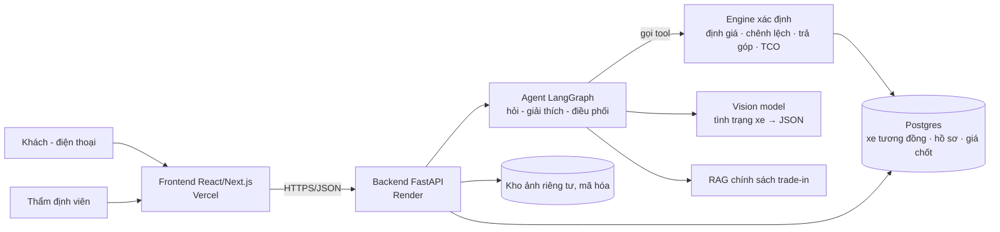
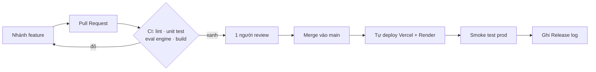

# 04 — Kiến trúc, Production & CI/CD

## 1. Kiến trúc một trang

**Nguyên tắc chia việc giữa LLM và code** (đây là ràng buộc của đề, cũng là thứ giám khảo sẽ soi):

| LLM / vision được làm | Chỉ code được làm |
|---|---|
| Hỏi lại thông tin thiếu, diễn giải kết quả bằng lời | Mọi phép cộng trừ nhân chia ra con số tiền |
| Mô tả hư hỏng trong ảnh thành JSON (loại, vị trí, mức độ) | Đổi mức độ hư hỏng thành số tiền trừ (bảng quy tắc) |
| Trả lời phản đối có trích nguồn | Khoảng giá, chênh lệch, lịch trả góp, TCO |
| Chọn tool nào gọi tiếp | Phân quyền, chốt giá (do người thật bấm) |

Agent **không bao giờ** viết ra một con số tiền mà không lấy từ kết quả của engine. Có test cho điều này (file 05).

## 2. Tech stack đề xuất

| Lớp | Chọn | Lý do |
|---|---|---|
| Frontend | Next.js (React) + Tailwind, deploy Vercel | Đề gợi ý React + Vercel; mỗi PR tự có link xem thử |
| Backend | FastAPI (Python) | Đề gợi ý; cùng ngôn ngữ với phần AI và dữ liệu |
| Agent | LangGraph | Đề gợi ý; luồng nhiều bước có trạng thái |
| CSDL | Postgres (Supabase hoặc Neon) | Miễn phí, không hết hạn như Postgres miễn phí của Render |
| Ảnh | Supabase Storage (bucket riêng tư) hoặc Cloudflare R2 | Link ký có thời hạn; mã hóa khi lưu |
| LLM + vision | Một model đa phương thức có gói miễn phí (xem tài liệu đăng ký của mentor) | Bắt đầu bằng API có sẵn; chỉ tự huấn luyện nếu còn thời gian |
| Đo lường | Sentry (lỗi), UptimeRobot (uptime), Langfuse (chi phí và vết LLM), Clarity (hành vi) | Đều có gói miễn phí |

**Về computer vision (sub-MVP).** Đi theo hai bậc để luôn có thứ chạy được:

1. *Bậc 1 (W2):* gửi ảnh cho model đa phương thức, yêu cầu trả JSON theo schema cố định. Nhanh, không cần huấn luyện.
2. *Bậc 2 (W4, nếu còn thời gian):* mô hình phát hiện hư hỏng huấn luyện trên bộ CarDD để so sánh với bậc 1 trên cùng bộ ảnh test. Chỉ thay nếu đo được là tốt hơn.

## 3. Production trong 2 tháng

**Khuyến nghị: bắt đầu miễn phí, chỉ trả tiền cho backend khi gần demo.**

| Thành phần | Dịch vụ | Chi phí | Cần biết |
|---|---|---|---|
| Frontend | Vercel (Hobby) | 0 | Tự deploy khi merge; mỗi PR có link preview |
| Backend | Render (Free) → Render (Starter) trong các tuần demo | 0 → khoảng 7 USD/tháng | Gói miễn phí **ngủ sau khoảng 15 phút không dùng**, lần gọi đầu mất gần 1 phút. Tạm xử lý bằng UptimeRobot ping `/health` mỗi 5 phút |
| CSDL | Supabase (Free) hoặc Neon (Free) | 0 | Supabase miễn phí tạm dừng project nếu cả tuần không hoạt động; ping ở trên giữ cho nó thức |
| Ảnh | Supabase Storage / R2 | 0 | Nén ảnh ở client xuống dưới ~500 KB |
| Domain | `*.vercel.app` / `*.onrender.com` | 0 | Domain riêng khoảng 10–15 USD/năm, không bắt buộc |
| LLM + vision | Gói miễn phí | 0 – vài USD | Đặt giới hạn số ảnh mỗi hồ sơ và số yêu cầu mỗi IP |

**Tổng 2 tháng:** 0 USD nếu chấp nhận backend khởi động chậm; khoảng **14–20 USD** nếu nâng Render lên gói trả phí. Giá dịch vụ thay đổi, kiểm tra lại trang giá trước khi nâng gói.

**Phương án VPS** (khi nào cần): một VPS 2 vCPU / 4 GB (Hetzner, hoặc nhà cung cấp trong nước nếu cần độ trễ thấp ở Việt Nam), chạy Docker Compose (FastAPI + Postgres + Caddy tự cấp HTTPS), deploy bằng GitHub Actions qua SSH. Khoảng 5–10 USD/tháng. Chỉ nên chuyển nếu: backend cần chạy model nặng, gói miễn phí không chịu nổi, hoặc mentor yêu cầu. Cái giá phải trả là nhóm tự lo sao lưu, bảo mật và cập nhật máy chủ — với 5 tuần thì chi phí thời gian này lớn hơn vài USD tiết kiệm được.

**Môi trường:**

| Môi trường | Ở đâu | Dùng để |
|---|---|---|
| Local | Máy từng người, `docker compose up` | Viết code |
| Preview | Vercel preview của từng PR + một backend `staging` | Review và UAT trước khi merge |
| Production | Nhánh `main` | Người dùng thật, demo |

Mỗi môi trường một bộ biến riêng (`.env`), CSDL riêng. Không dùng chung CSDL giữa staging và prod.

## 4. CI/CD từ ngày đầu

**Việc cần dựng ở Bước 0 (T-002 đến T-004):**

1. Repo GitHub, cấu trúc `frontend/`, `backend/`, `data/`, `evals/`, `docs/`.
2. Bảo vệ nhánh `main`: không push thẳng, phải qua PR, CI phải xanh, 1 người duyệt.
3. GitHub Actions trên mỗi PR: lint (ruff, eslint) → unit test (pytest, vitest) → eval engine → build.
4. Vercel và Render nối với repo: merge `main` là tự deploy.
5. Sau deploy: một job gọi `/health` và một lần định giá mẫu trên prod. Hỏng thì báo vào kênh chat.
6. **Walking skeleton:** ngay trong Bước 0, trang chủ trên prod phải gọi được backend và đọc được 1 dòng từ CSDL. Chưa có tính năng nào cũng được, miễn là đường ống thông.

**Quy tắc git của nhóm:**

- Nhánh: `feature/us-01-wizard`, `fix/bug-012-upload`, `chore/...`.
- Commit nhỏ, thường xuyên, bắt đầu bằng động từ: `add valuation range endpoint`, `fix mileage validation`.
- PR dưới 400 dòng, tiêu đề có mã US hoặc mã bug, mô tả: đổi gì, vì sao, test thế nào.
- Tính năng dở dang vẫn merge được nếu **ẩn sau cờ bật/tắt** — đó là cách deploy nhiều lần mỗi ngày mà không làm hỏng prod.
- `CHANGELOG.md` trong repo + sheet **Release log**: mỗi lần deploy một dòng, viết cho người dùng đọc.
- Không commit `.env`, API key, ảnh xe của khách.

## 5. "Chạy được trên máy khách hàng"

Khách hàng mục tiêu chủ yếu dùng điện thoại. Định nghĩa "chạy tốt" của nhóm:

| Tiêu chí | Ngưỡng |
|---|---|
| Thiết bị | Android tầm trung và iPhone; Chrome, Safari, trình duyệt trong Zalo / Facebook |
| Màn hình | Từ 360 px, không cuộn ngang, nút bấm đủ lớn |
| Mạng | Dùng được trên 4G yếu; ảnh nén trước khi gửi; có thanh tiến trình và thử lại |
| Tốc độ | Trang đầu dưới 3 giây; định giá (không ảnh) dưới 2 giây; có ảnh dưới 15 giây kèm thông báo đang xử lý |
| Lỗi | Mất mạng giữa chừng không mất dữ liệu đã nhập |

Mỗi sprint, mỗi người chạy UAT trên **điện thoại thật của mình**, không chỉ trên trình duyệt máy tính.

## 6. Bảo mật tối thiểu

- Ảnh trong bucket riêng tư, chỉ truy cập qua link ký có thời hạn. Xóa dữ liệu vị trí (EXIF) khi tải lên.
- Phân quyền kiểm tra ở backend: khách chỉ xem hồ sơ của mình, thẩm định viên chỉ xem hồ sơ được giao.
- Biển số và số điện thoại không ghi vào log, không gửi cho LLM nếu không cần.
- Giới hạn số yêu cầu theo IP cho endpoint tải ảnh và endpoint gọi LLM.
- Có trang thông báo ngắn: thu thập gì, để làm gì, giữ bao lâu; người dùng tick đồng ý trước khi tải ảnh.
